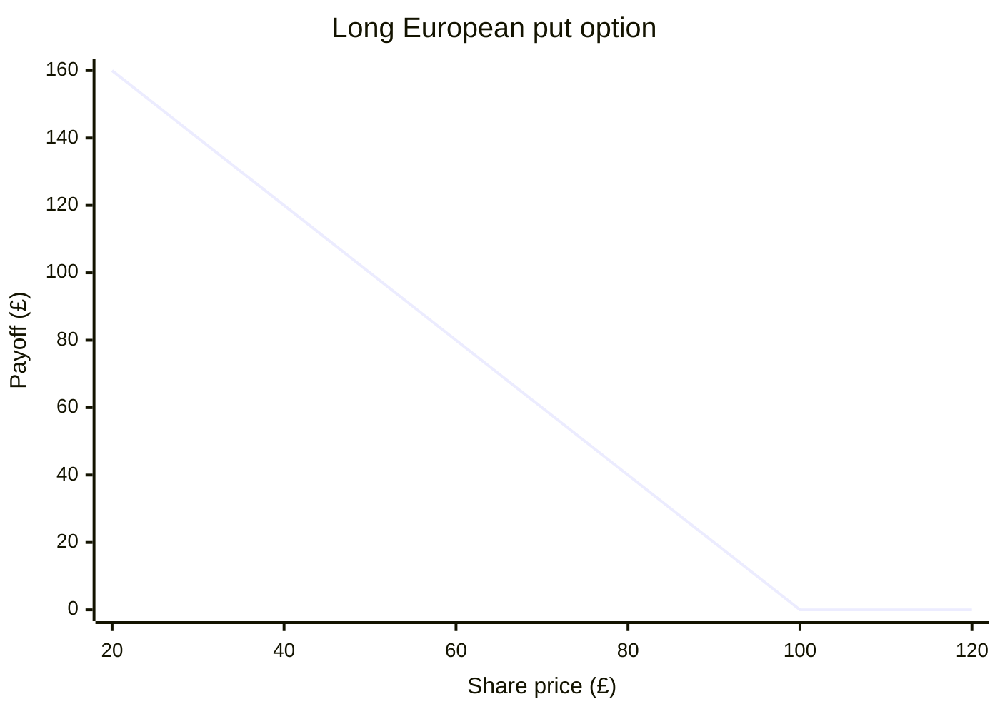

# 6. Equities and Derivatives

[Back to contents](../README.md)

## Summary

A **forward contract** is an OTC transaction between 2 parties whereby the seller promises to sell a specified amount, N, of an
underlying asset at a pre-determined price, K, at a pre-determined specified date, T, and in return the buyer must buy the asset.

This is different to an **option contract** which gives the buyer the right but not the obligation to buy (in the case of a **call option**) or sell
(in the case of a **put option**) a specified amount of an underlying asset at a pre-determined price and a pre-determined specified date from the seller. 

A **European option** can only be exercised at expiry whereas an **American option** can be exercised at anytime up to an including expiry.

Let $S_t$ represent the price at time t of an asset. The **forward payoff function** satisfies f(x) = S - K     
The **forward price**, F, at t=T satisfies F = $\frac{S_0}{D(T)}$ where D(T) is the discount factor to time t. 

The payoff from a call option satisfies ($S_t$ - K)^+ and the payoff from a put option satisfies (K - $S_t$)^+ where the function x^+ = x if x \geq 0 and 0 
othwerise.

**Call put parity** enables us to connect the price of a call option to the price of a put option. Let C = call option price and P = put option price. Then,
C - P = $S_0$ - KD(T) where D(T) is the discount factor for time T. 

## My example

On November 12 2026, Rolls Royce's stock closed at about £13.70. Suppose an investor decides to adopt a bull call spread whereby they buy 1 call
option with a strike price of £14.50 paying a premium of £1 and sells 1 call option with a strike price of £17 receiving a premium of £0.60.
Assume Rolls Royce pays no dividends and the 2 call options have the same expiry date. Calculate the total profit at expiry based on when the share
price is between £12 and £19 for every £1 increment in this range.

**Answer**

The net premium the investor pays to from this strategy is £1 - £0.60 = £0.40. The payoff from the long call is max($s_T$ - 14.50, 0) while the payoff
from the short call is -max($s_T$ - 17, 0). Hence, total payoff = max($s_T$ - 14.50, 0) - max($s_T$ - 17, 0). Thus, total profit = total payoff -0.40 = 
max($s_T$ - 14.50, 0) - max($s_T$ - 17, 0) - 0.40. So, substituting the values for $s_T$ we get 

| Share price at expiry (£) | Total payoff (£) | Total profit (£) |
| ---: | ---: | ---: |
| 12 | 0 | -0.40 |
| 13 | 0 | -0.40 |
| 14 | 0 | -0.40 |
| 15 | 0.50 | 0.10 |
| 16 | 1.50 | 1.10 |
| 17 | 2.50 | 2.10 |
| 18 | 2.50 | 2.10 |
| 19 | 2.50 | 2.10 |

## Solved exercises

### Exercise 6.4 (from Exercise Sheet 6)

Suppose that a stock is currently trading at £12, and that the current prices for European call and put options on a stock with maturity T = 10 and strike
price K = £30 are equal to £12.50 and 314, respectively. Assuming that interest is continuously compounded, use the put-call parity to deduce the current
interest rate.

**Answer**

### Exercise 6. (from Exercise Sheet 6)

**Answer**

## Spreadsheet

[06-Equities&Derivatives.xlsx](../spreadsheets/06-Equities&Derivatives.xlsx): this is the Excel version of the answer to my example. Change any of the
inputs in cells D5, D6, D7, D8, D9, D10 to see how the payoff and profit from this bull call strategy change.
